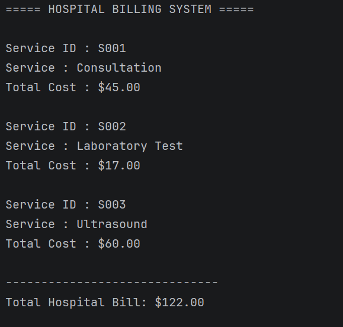

# Assignment 1: Employee Salary Management System

## Project Description
This Java program manages employees and calculates their monthly salaries. The company has full-time employees, part-time employees, and managers. Each employee type has a different way of calculating salary.


## Expected Output

```

## Assignment Questions and Answers

### 1. Identify the superclass and subclasses.
The superclass is `Employee`. The subclasses are `FullTimeEmployee`, `PartTimeEmployee`, and `Manager`.

### 2. Explain how inheritance reduces code duplication.
Inheritance allows the child classes to use attributes and methods from the parent class. This means we do not need to write the same code again in every child class.

### 3. Identify the method that demonstrates polymorphism.
The `calculateSalary()` method demonstrates polymorphism because each child class overrides it to calculate salary differently. The program uses an `Employee[]` array to hold different types of employees.

### 4. Explain why @Override is used.
`@Override` shows that a child class is replacing a method from the parent class. It also helps Java find mistakes if the method does not match the parent method.
