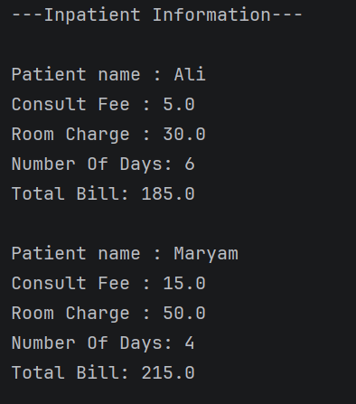
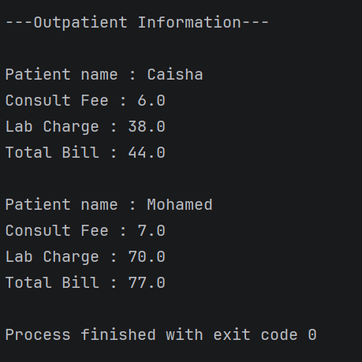

# Hospital Management System

**Project:** Hospital Patient Billing System  
**Language:** Java  
**Topic:** Object-Oriented Programming (OOP)

## Project Description

This project is a simple Hospital Management System that calculates patient bills for both inpatient and outpatient services.

It displays patient information, medical consultation fees, room charges, laboratory charges, the number of days spent in the hospital, and the total bill.

## 1. Inpatient Information

Inpatient billing includes the consultation fee and room charges based on the number of days the patient stays in the hospital.

### Output

| Patient Name | Consult Fee | Room Charge | Number of Days | Total Bill |
|---|---:|---:|---:|---:|
| Ali | 5.0 | 30.0 | 6 | 185.0 |
| Maryam | 15.0 | 50.0 | 4 | 215.0 |

**Calculation:**

- Ali: 5.0 + (30.0 × 6) = 185.0
- Maryam: 15.0 + (50.0 × 4) = 215.0

## 2. Outpatient Information

Outpatient billing includes the consultation fee and laboratory charges. Outpatients do not have room charges or hospital stay days in this program.

### Output

| Patient Name | Consult Fee | Lab Charge | Total Bill |
|---|---:|---:|---:|
| Caisha | 6.0 | 38.0 | 44.0 |
| Mohamed | 7.0 | 70.0 | 77.0 |

**Calculation:**

- Caisha: 6.0 + 38.0 = 44.0
- Mohamed: 7.0 + 70.0 = 77.0

## 3. Features

- Displays patient information.
- Calculates inpatient bills using consultation fees and room charges per day.
- Calculates outpatient bills using consultation fees and laboratory charges.
- Shows the total bill for each patient.
- Separates inpatient and outpatient information.

