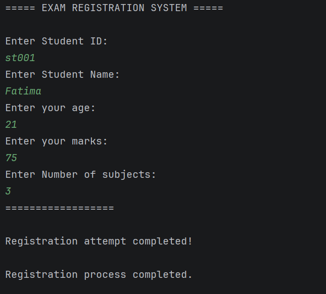

# Assignment 3: Exception Handling

## University Exam Registration System

## Expected Output

### 1. What is the purpose of the try and catch blocks?

The `try` block contains code that might cause an exception. The `catch` block handles the exception and displays an error message instead of letting the program stop unexpectedly.

In this application, they are used to handle invalid student registration information.

### 2. Explain the difference between throw and throws.

- **throw:** Used to create and throw an exception when an error occurs.
- **throws:** Used in a method declaration to indicate that the method may throw an exception.

In this application, `throw` is used when student information is invalid, while `throws` declares the custom exception in the validation method.

### 3. What is the purpose of the finally block?

The `finally` block executes after the `try` and `catch` blocks, whether an exception occurs or not during normal execution.

In this application, it displays the message "Registration attempt completed."

### 4. Why is a custom exception useful in this application?

A custom exception allows us to create our own error type for specific problems.

In this application, `InvalidRegistrationException` is used when a student enters invalid information, such as an incorrect age, exam mark, number of subjects, or student ID.

It makes the program easier to understand and provides meaningful error messages.